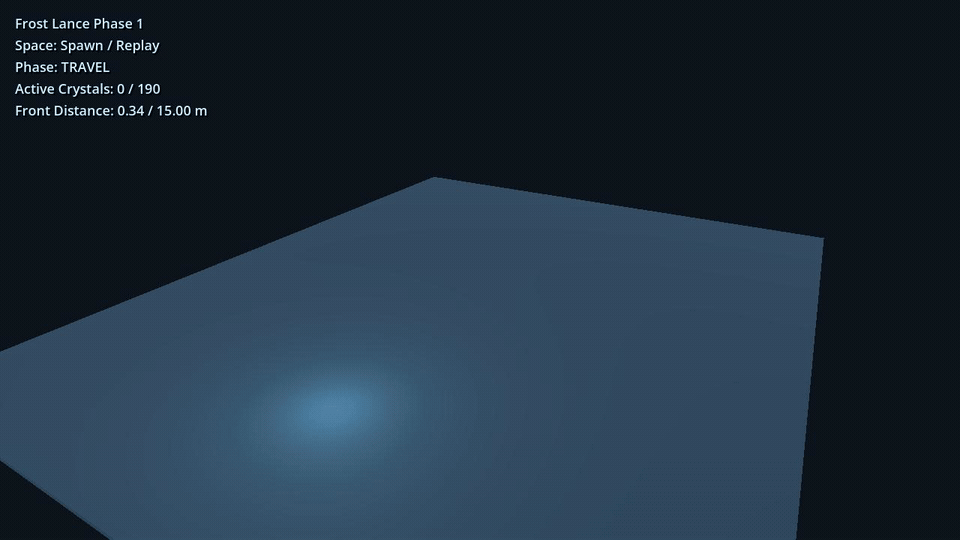

# Godot Ice Spike VFX

*Frost Lance Experiment*

A procedural ice-spike ability VFX experiment built in Godot 4.

[Watch or download the high-resolution MP4 preview](media/ice-spike-preview.mp4).

## Overview

This project explores a stylized procedural ice-spike ability built for
Godot 4 using the Compatibility renderer.

## Features

- Procedurally generated ice crystal geometry with multiple variants
- Propagating spike eruption with a hold and sink / fade lifecycle
- Ice material with Fresnel, fracture, veins, rime and glint
- Mist, shards and glitter particles
- Ground frost path and impact effects
- Frost burst and shockwave
- Screen-space bloom-style feedback
- Camera shake and impact feedback

## Requirements

- Godot 4.7; tested with Godot 4.7.1 stable
- Compatibility renderer (OpenGL)

## How to run

1. Clone or download the repository.
2. Open `project.godot` in Godot 4.7.x.
3. Press **F5**.
4. Press **Space** to cast or replay the Ice Spike effect.

Main scene: `res://FrostLanceExperiment.tscn`.

## Project structure

`project.godot` and `FrostLanceExperiment.tscn` define the project and standalone demo scene.

- `scripts/`: `FrostLanceExperiment.gd` (ability lifecycle),
  `CrystalGeometryBuilder.gd` (geometry), `IceCrystalShaderController.gd`
  (material parameters), `FrostLanceParticles.gd`, `FrostLanceGroundFX.gd`
  and `FrostLanceFeedback.gd`.
- `shaders/`: ice crystal, ground frost, frost burst, shockwave,
  particle and bloom feedback shaders.
- `media/`: GIF, MP4 and poster previews captured from this demo.

## Notes and limitations

- This is a VFX experiment, not a complete combat system.
- The project targets Godot's Compatibility renderer.
- Some rendering techniques are Godot-specific adaptations of the original
  Three.js implementation.
- Visual validation has been performed on an NVIDIA GTX 1050.

## Credits

Portions of the procedural ice ability and effect structure are adapted from
[LinearAbiltyCastingThreeJS](https://github.com/achrefelouafi/LinearAbiltyCastingThreeJS)
by mohamedachrefelouafi, licensed under the MIT License.

See [THIRD_PARTY_NOTICES.md](THIRD_PARTY_NOTICES.md) for full attribution and license text.

## License

This project is released under the [MIT License](LICENSE).

Third-party components and adapted work retain their original attribution.
See [THIRD_PARTY_NOTICES.md](THIRD_PARTY_NOTICES.md).
